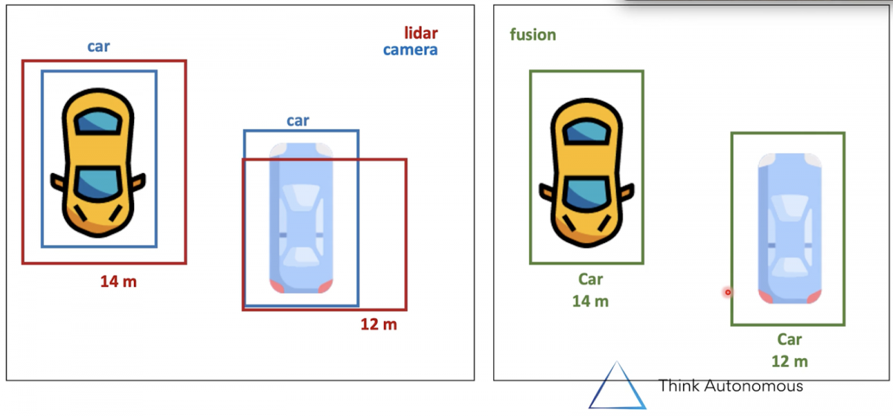
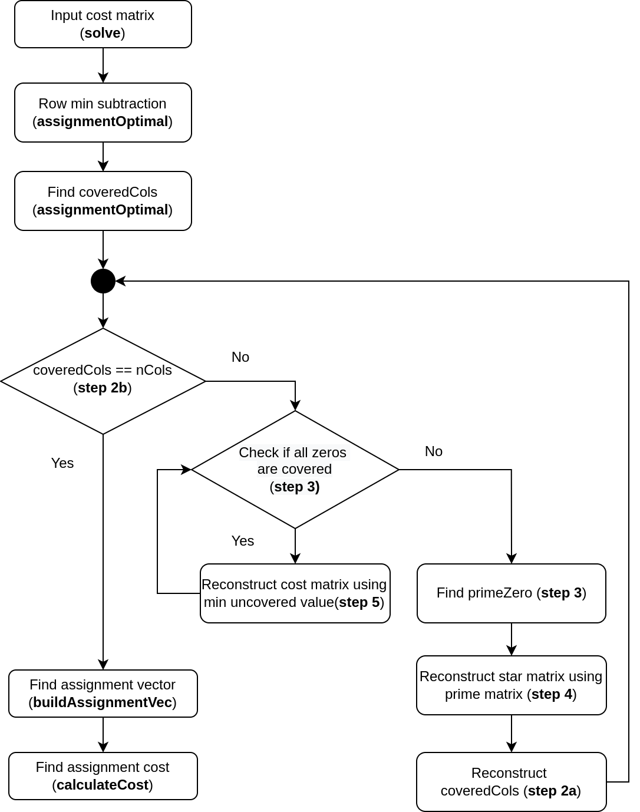

# Hungarian Algorithm

## Overview
- [Hungarian algorithm](https://onlinelibrary.wiley.com/doi/abs/10.1002/nav.3800020109) is an optimization method to solve "linear assignment problem" in polynomial time (O(n^3))
- It was presented in 1955 by HW Kuhn, and time complexity was verified by James Munkres in 1957. Hence, referred to as Kuhn–Munkres algorithm / Munkres algorithm / Hungarian method (as it's based on work of two Hungarian mathematicians)
- Given a set of jobs / tasks with specific cost associated with each of them, and finite set of workers / resources to do them, Hungarian algorithm is guaranteed to find `global minimum (best solution) that minimizes the cost`.
- Time complexity - O(N^3). Memory -  O(N^2).

## Applications to Perception domain
- Often used for solving **Data association problem in Object Tracking Applications**. In the following image, we need to associate the detections from Lidar to detections in camera. Essentially, hungarian algorithm can be used to associate data from different sensors, so as to fuse them to get better estimations



[Image reference](https://www.thinkautonomous.ai/blog/?p=hungarian-algorithm)

- General constraints
    - One detection can be assigned to maximum of one track
    - One track can be associated with maximum of one detection
- Find the minimum cost, when sticking with above constraints
- It's also one of the foundations for tracking algorithms like [SORT (Simple Online and Realtime tracking)](https://arxiv.org/pdf/1602.00763.pdf)

## Pros
- Guaranteed optimal results
- Deterministic results
- Polynomial time complexity is better than brute force approach (O(N!))

## Cons
- O(n^3) scales poorly with larger inputs
- Original implementation works only for square matrices. For non-square rows, need to add dummy rows / columns
- Can work only with single objective function. Doesn't handle constraints.
- Doesn't work well with sparse inputs; doesn't offer any speed inputs.

## Algorithm implementation

### Requirements
The code was developed on Ubuntu 22.04 LTS OS with
- g++ 11.4.0
- cmake 3.22.1
- Eigen 3.4.0

```bash
# installs dependencies
sudo apt install -y build-essential cmake libeigen3-dev
```

### How to run the project
```bash
cd <path/to/hungarianAlgorithm>
mkdir -p build && cd build
cmake ..
make
./hungarian_algorithm
```

## Alternatives to Hungarian algorithm

### Jonker-Volgenant algorithm
- `Jonker-Volgenant (LAPJV)` is often used, instead of Hungarian algorithm, for linear assignment problems. **The limitation of Hungarian algorithm is that it can perform substantial matrix-wide operations and repeated searches, particularly for larger problems.**
- [scipy's linear_sum_assigment implementation](https://docs.scipy.org/doc/scipy/reference/generated/scipy.optimize.linear_sum_assignment.html) works for 2D rectangular assignment problems, and uses variation of Jonker Volgenant algorithm. [scipy lsap cpp code](https://github.com/scipy/scipy/blob/main/scipy/optimize/rectangular_lsap/rectangular_lsap.cpp)
- Key changes
    - Dual Initialization. Introduces fast column reduction, reduction transfer, and augmenting row reduction routines to establish a strong initial partial solution before path searching begins.
    - Shortest Augmenting Path. Uses a specialized implementation of Dijkstra's algorithm to find minimum-cost augmenting paths to unassigned columns, achieving O(N³) worst-case time complexity while outperforming the standard Hungarian (Kuhn-Munkres) method in practice.
    - Dense & Sparse Support. Adapts the data structures to handle both complete (dense) cost matrices and incomplete (sparse) graphs efficiently.
- Improvements over Hungarian algorithm
    - Avoiding unnecessary matrix operations. Traditional Hungarian implementations repeatedly adjust the cost matrix when they cannot find a complete matching. JV uses dual variables and reduced costs to perform these adjustments more selectively.
    - Better augmenting path search. JV uses shortest augmenting paths and maintains information about promising alternatives. This avoids repeatedly restarting the assignment search from scratch.
    - Native rectangular matrix handling. This is particularly useful in tracking applications. Suppose you have 100 existing tracks, 65 detections. You don't need to add 35 dummy rows just to create a square 100 × 100 matrix in a rectangular-capable implementation. JV can solve the 100 × 65 problem directly (or transpose it internally, depending on the implementation).
- **JV does not necessarily improve the theoretical worst-case complexity (still O(n^3)). Its advantage is primarily in practical execution speed and implementation efficiency.**

- Related papers
    - [Original Jonker Volgenant paper - A Shortest Augmenting Path Algorithm for Dense and Sparse Linear Assignment Problems](https://link.springer.com/article/10.1007/BF02278710)
    - `Followup paper - Jonker-Volgenant (LAPJV) Small-to-medium dense matrices	Exact Faster than Hungarian in practice`
- Reference implementations 
    - https://ms609.github.io/TreeDist/reference/LAPJV.html
    - https://github.com/yongyanghz/LAPJV-algorithm-c/tree/master
    - [python lapjv implementation](https://github.com/Bram94/lapjv/tree/master)

### Auction Algorithm
- Works for Large sparse graphs & parallel setups
- Exact (with ε-scaling)
- Very fast on sparse/parallel hardware

## Contributions from this repo
- Implementation is forked from [repo](https://github.com/mcximing/hungarian-algorithm-cpp) but has been improved upon by
    - Using `Eigen` library for array operations
    - Added docstring and flowchart for better understanding of implementation

## Algorithm workflow


## References
- [thinkautonomous blog post](https://www.thinkautonomous.ai/blog/?p=hungarian-algorithm)
- [wiki page](https://en.wikipedia.org/wiki/Hungarian_algorithm)
- [Markus Buehren inspired c++ implementation](https://github.com/mcximing/hungarian-algorithm-cpp)
- [Python implementation](https://python.plainenglish.io/hungarian-algorithm-introduction-python-implementation-93e7c0890e15)
- [C implementation with explanation](https://brc2.com/the-algorithm-workshop/)
- [c++ implementation](https://github.com/saebyn/munkres-cpp)
- [Comparison of assignment problem implementation](https://github.com/Yay295/AssignmentProblemComparison)
- [cpp best practices](https://github.com/Gluttton/cppbestpractices/blob/master/04-Considering_Safety.md)
