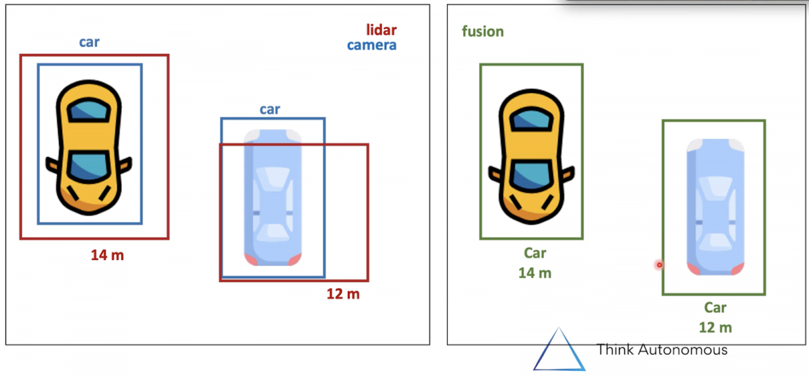
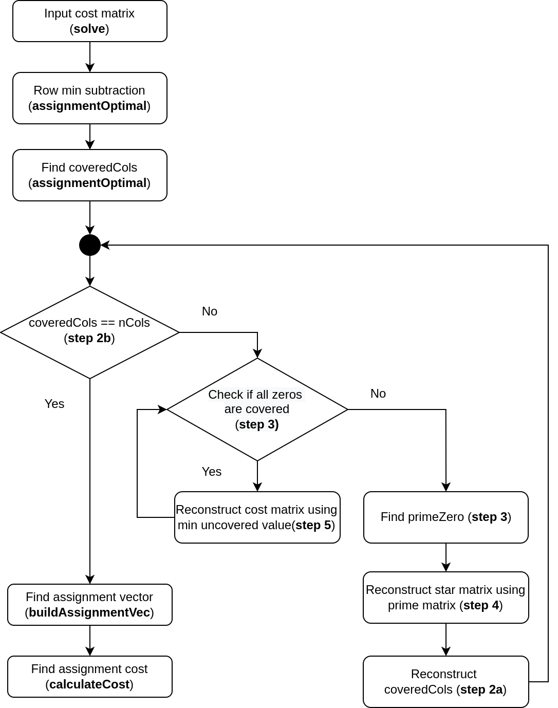

# Hungarian Algorithm

## Overview
- [Hungarian algorithm](https://onlinelibrary.wiley.com/doi/abs/10.1002/nav.3800020109) is an optimization method to solve "linear assignment problem" in polynomial time (O(n^3))
- It was presented in 1955 by HW Kuhn, and time complexity was verified by James Munkres in 1957. Hence, referred to as Kuhn–Munkres algorithm / Munkres algorithm / Hungarian method (as it's based on work of two Hungarian mathematicians)
- Given a set of jobs / tasks with specific cost associated with each of them, and finite set of workers / resources to do them, Hungarian algorithm is guaranteed to find `global minimum (best solution) that minimizes the cost`.
- Time complexity - O(N^3). Memory -  O(N^2).

## Applications to Perception domain
- Often used for solving **Data association problem in Object Tracking Applications**. In the following image, we need to associate the detections from Lidar to detections in camera. Essentially, hungarian
algorithm can be used to associate data from different sensors, so as to fuse them to get better estimations



[Image reference](https://www.thinkautonomous.ai/blog/?p=hungarian-algorithm)

- It's also one of the foundations for tracking algorithms like [SORT (Simple Online and Realtime tracking)](https://arxiv.org/pdf/1602.00763.pdf)
- [scipy's linear_sum_assigment implementation](https://docs.scipy.org/doc/scipy/reference/generated/scipy.optimize.linear_sum_assignment.html) works for 2D rectangular assignment problems

## Pros
- Guaranteed optimal results
- Deterministic results
- Polynomial time complexity is better than brute force approach (O(N!))

## Cons
- O(n^3) scales poorly with larger inputs
- Original implementation works only for square matrices. For non-square rows, need to add dummy rows / columns
- Can work only with single objective function. Doesn't handle constraints.
- Doesn't work well with sparse inputs; doesn't offer any speed inputs.

## Algorithm implementation

### Requirements
The code was developed on Ubuntu 20.04 LTS OS with
- g++ 9.4.0
- cmake 3.16.3
- Eigen 3.3

### How to run the project
```bash
cd <path/to/hungarianAlgorithm>
mkdir -p build && cd build
cmake ..
make
./HUNGARIAN_ALGORITHM
```

## Alternatives

### Algorithm workflow


### Implementation details
- This module contains C++ implementation of the [Hungarian algorithm](https://web.eecs.umich.edu/~pettie/matching/Kuhn-hungarian-assignment.pdf). In perception domain, it is often used in `data association` step of object tracking.
- Eg : If the Cost of doing work for different workers can be tabulated as follows :

| Worker / Task      | Task 1 | Task2 | Task3 | Task4 |
| -------------------| -------| ------| ------| ------|
| Worker A           | 5      | 9     | 3     | 6     |
| Worker B           | 8      | 7     | 8     | 2     |
| Worker C           | 6      | 10    | 12    | 7     |
| Worker D           | 3      | 10    | 8     | 6     |

- The optimal assignment for the above is
    - Worker A -> Task 3
    - Worker B -> Task 4
    - Worker C -> Task 2
    - Worker D -> Task 1
- Total Optimal cost = 3 + 2 + 10 +3 = 18
- The implementation is forked from [repo](https://github.com/mcximing/hungarian-algorithm-cpp) but has been improved upon by
    - Using `Eigen` library for array operations
    - Added docstring and flowchart for better understanding of implementation
- Theoretically, it solves the primal-dual optimization problem. [Reference : NPTEL operations research course](https://www.youtube.com/watch?v=BUGIhEecipE)


## References
- [thinkautonomous blog post](https://www.thinkautonomous.ai/blog/?p=hungarian-algorithm)
- [wiki page](https://en.wikipedia.org/wiki/Hungarian_algorithm)
- [Markus Buehren inspired c++ implementation](https://github.com/mcximing/hungarian-algorithm-cpp)
- [Python implementation](https://python.plainenglish.io/hungarian-algorithm-introduction-python-implementation-93e7c0890e15)
- [C implementation with explanation](https://brc2.com/the-algorithm-workshop/)
- [c++ implementation](https://github.com/saebyn/munkres-cpp)
- [Comparison of assignment problem implementation](https://github.com/Yay295/AssignmentProblemComparison)
- [cpp best practices](https://github.com/Gluttton/cppbestpractices/blob/master/04-Considering_Safety.md)
