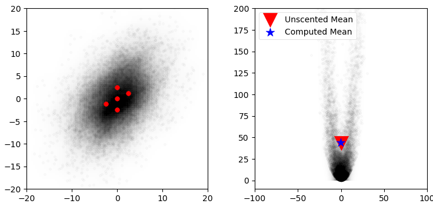
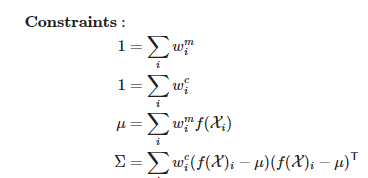
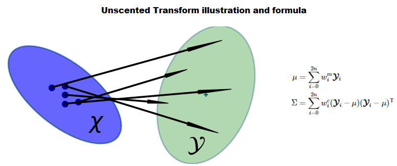
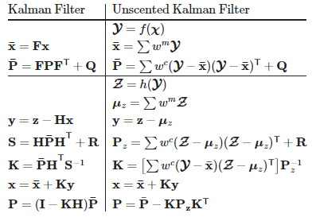
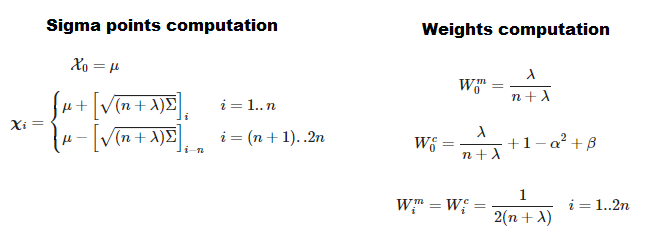

## Unscented Kalman Filters
- Unscented Kalman filters (UKF) are a recent development in Kalman filter theory. They allow you to filter nonlinear problems without requiring a closed form solution like the Extended Kalman filter requires.
- [Chapter 10 Notebook](https://github.com/rlabbe/Kalman-and-Bayesian-Filters-in-Python/blob/master/10-Unscented-Kalman-Filter.ipynb)

## Points to remember
- Non linearity, can come from either measurements or the process model.
- Pg:343: Monte carlo approach for any NL problems (particle filters, ensemble filters), but num points, without any sound logic (also, points need to be scaled across dimensions; ~500k^n_dimension), will be >>>. Not practically possible
- Smart way of choosing sigma points = sampling from distribution. There are deterministic ways to sample from a Gaussian distribution.

- For linear case, we're choosing one point (min number, possible for a dsitribution), but for a non linear case, need more than one point, to track the behaviour a bit futher away from the mean. Also considering the fact that Gaussians are symmetric, we need at least three points minimum. So, instead of sampling using 500k points, we need at least three points. These three points represent the distribution in a way. We can pass them through non-linear function, to get output. But the output mean is weighted sum of the three output means. The weights shall sum up to one. Similarly, the output covariance is also, weighted sum of output covariance for each sigma point.

- Pg:347-348. Intuition for choosing (2n+1) points , symmetry & mean. Constraints on points weights. intuition behind sigma pts vis. Note that constraints don't form a unique solution. If we increase w_c_0, we can reduce w_c_1, and other components to compensate - nothing limits / prevents us from doing that. Arrangement and weighting of sigma points affects how we sample the distribution. If points are close together, then, local non-linearity will be accounted for, but farther away, effects are not captured. We will need to weight the mean as well accordingly.

- Pg:349-350: Very basic example of unscented Transform, Viz. Unscented transform takes points, sampled from arbitary probability distribution, passes them through arbitary non linear function, and produces a Gaussian for each transformed point.

- Pg:351-352: UKF equations for any sigma pt method, update + predict step. From mean, covariance, we create sigma points, pass through non linear function, calculate weighted sums to get prior mean, covariance. Then, we pass this prior through measurement function, to get values in measurement space. This can be used to calculate residual for each sigma point, in measurement dimension. To compute Kalman gain, we compute cross covariance of state and measurements (x and z dimension). KG ~= P_xz (belief in state) / Pz (belief in measurement)

- Pg:353-359: Van der merwe sigma point selection formula. Industry standard since 2005. Three parameters -alpha,beta, kappa to control output. The sigma points lie between first and second sigma. alpha does two things - spreads non-mean sigma points, and gives more weightage to the "mean" sigma point. Below formula, shows sigma point generation, requiring taking square root of the covariance matrix. Then, each row is added / subtracted from the mean, to provide symmetry.

- Weights for mean and non-mean sigma point slightly difference. Roughly, it translates to taking +- 1sigma and scaling as desired. **Reasonable choices for parameters - beta = 2 for gaussian distribution; kappa = 3 - n, where is state dimension; alpha is [0,1]. Weights need not sum to one; infact, they often are greater than one or negative; Kappa will be negative as well, for higher dimensions**

- Pg:358 Tracking an airplane problem setting up. Military grade Radar achieves `1m RMS range accuracy and 1mrad elevation angle accuracy`. **angle wrapping (NL) problem**. Example of how to use UKF for tracking range distance and height of an aircraft, using radar.
- Pg:365-367: Why complementary sensors give better results in SF? Using doppler system for calculating velocity, improves std.deviation. Similarly, combining low frequency, more accurate position estimate + poor velocity estimate GPS sensors with higher frequency less accurate position + more accurate velocity estimate from Inertial measurement "complements" each other.
- Pg:370-372 Geometry affects 2 bearing sensor fusion. For example, if two position sensors are placed few "meters" apart, and used to estimate the heading angle of the object, then "distance offset" impact how sensitive, the output angle estimate is. If the sensors are placed very closely, a very small error in distance, will result in larger error in angle estimate. **Also, the behaviour is non-linear in x and y direction**. If we initialize filter to very incorrect value, and have a very small process noise as well, then filter can't converge.
- Pg:373. Square root of matrix (A) is a matrix S, such that S*S.transpose() = A. If we consider this definition, S can be computed using Cholesty decomposition. In this case, we assume numpy returning uppper triangular matrix. Hence, we need to take each row as sigma point. If a different implementation provides a lower triangular / symmetric matrix, then, each column will be a sigma point. As numpy is written in C, Fortran, its much faster, compare to Python. Use RTS smoother if post-processing filter results.
- Pg:380-381 Choosing sigma points pta in Var der Merwe method. beta=2 for Gaussian distributions is almost fixed. Main varying parameter is `alpha`. If this value is closer to 1, it will generate sigma points closer to mean, and give more weightage as well, but if its very hugh (eg: 200), then the sigma points are generated very far away from mean, and their weightage is also less. If we have very non-linear function, lower alpha values is better. If we had non-Gaussian distribution (very fat tails), then we'd need larger `alpha` values. **10e-3 is good starting value for alpha**
- **Pg 384-390 Robot localisation problem. UKF solution particularly handling NL among angles in h(x), f(x), sigma points and and finding weighted mean, cov**
    - State variables being [x,y,theta].
    - Commanded velocity and steering angle are inputs, but velocity is not part of state vector, to make it reasonable.
    - Bicycle model for process model, small delta_t ensures Euler's integration method works fine. If delta_t is bigger, prefer RK4 numerical integration method.
    - Measurement is through a range-bearing sensor, that gives range, bearing to known targetss in the environment. [range, theta]. Measurement function has to convert state estimate to range-bearing.
        - Bearing measurements, need to take || of the difference - when computing the residual.
    - Unscented transform computes the average of mean, and covariance, but naive implementation of 359degrees and 3degree will give 181 as average value. **Need to normalize in many steps when dealing with angles**
- Pg : 391 : Pros of UKF over EKF. This is Julier's scaled uncscented filter , and parametrized by Van der Merw's 2004 dissertion. There are other variants of sigma point filters (search for Julier, Van der Merwe, Uhlmannn and Wan-)
