## Designing Kalman Filters
- Chaptere discusses different examples to give you a start towards implementing your own filters.Notable points on numerical stability.
- [Chapter 8 Notebook](https://github.com/rlabbe/Kalman-and-Bayesian-Filters-in-Python/blob/master/08-Designing-Kalman-Filters.ipynb)

## Points to remember
- Pg:262 2D Pose senser simulation (CV) model. returns x_s, z_s
- 2D Tracking problem. Pg: 262 **Step1:** Choosing state variables. List down variables of interest, using some form of mathematical expressions **(x)**. Make sure, you're able to generate good information about the hidden variables, after filter is running.

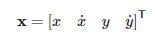

- Pg:263 **Step2:** State transition fn. Define the continous ODEs that describe the phyiscal system. (eg: CV model, CA model). Discretize the continous eqns to get state transition matrix , which helps propagate state in prediction step. **(A)**. This step can be used to introduce any known correlation.

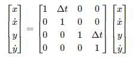

- Pg:264. **Step3:** Process noise Discrete wiener/white noise - helps assigning a variance, that changes between each step. Choose delta_a variable for general CA, CV and related systems (uncertainty that will be added to state vector with each time period) **(Q)**.

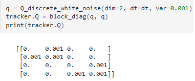

- **Step4:** control I/P (B). If aware of control input to system, try to model that using `delta_x = B * u` form. **(B)**

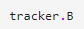

- **Step5:** Measurement fn. **(H)** . This function / matrix converts the predicted state to measurement space (x -> z).

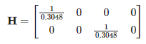

- **Step6:** Measurement noise. **(R)**. Generally, covariance b/w sensor measurements is not known. Hence it'd be mostly diagonal matrix

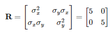

- **Step7:** Initial conditions (x,P)

- Pg:268. Filter order = degree of highest form, (CA=2, CV=1). order of system = design choice. If something can travel mostly with const. vel use order=1, else it'd be bad choice. Even constant acceleration model (order = 2) is a bad choice in that case.
- Pg:270-272, 1st, 2nd and 0th order (ID) Tracking filter code. Pg:273 fn to Plot residual: from batch o/p data **Here Residual = diff b/w x_gt, x_est**
- **Pg:274, residual within 1sigma range, zero mean, not diverging check for each state**
- Ways to evaluate a filter - Need ground truth to be available. residuals = diff between ground truth and estimated values. Plot 3sigma of `P_posterior`. If its performing correclty, 99% of residuals will be within 3sigma of `P_posterior`. For real sensors, we might need to expand the criteria of 5sigma (99.99999xxx% of residuals must fall within particular range)
- Ideally, if there was zero measurement noise and KF was perfect, residuals must be horizontal line at 0. The residuals need to be looked at for all state variables (position, velocity)

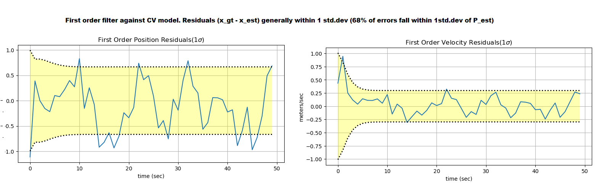

- Pg:275-276. Failure of 0th order filter to model/estimate velocity changes. `Residual seems to diverge even though P_est is decreasing / converged (converging)`. P_est reflects how confident, the filter is, in its own estimates. But if residuals exceed that, it indicates difference between actual system and reality. We assume there is no change in velocity, but in reality there is. But we discover that only through measurement. Hence, filter output always lags behind ground truth, in updating to latest velocity.

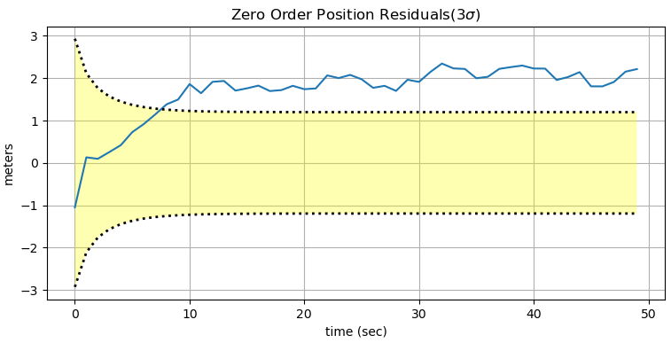

- Pg:275-276. 2nd order filter, trying to model small delta_V as acceleration, closely tracks noise in measurements, reflected in velocity residual

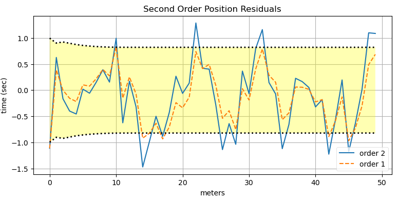

- Pg:279 To counter this, if we reduce Q (less trust in measurements) -> Large lag in position residuals (**diverging. cannot recover from bad initialisation**). polyfit analogy (Pg:281 fitting parabola to st.line overfitting - infinite solutions, which will diverge, when provided with different dataset / initialization point.)
- **Lower order filter can track higher order physical process, provided, the process noise is that much higher and sampling frequency is higher; the system is almost linear in ~10ms duration**. Example: Physical process - CA model, but try tracking using CV model KF. Filter generally lags behind, for its not able to model acceleration, if Q>, it will perform decently. so if Q>>, very close to meas.noise (Pg: 284-285).
- Pg:288 Don't incorporate all measurements directly, check for outliers. Pg:290 Just checking diff b/w (x) and (z) won't work coz, it disregards the uncertainty values, that we've been tracking. Risk of losing valid measurements (particularly as start, when filter is just initialized with guessed values). Need to incorporate P also. Generally, use 4 standard deviation as threshold -> If measurement is outside 4sigma, consider it an outlier and don't use for update. This is the lower limit (can go to 5sigma, 6sigma, but never below 4sigma). Normal if checks using sigma, would be rectangular gating -> can include bad measurements as well.

- Pg:291 Gating concept. `Pg:292 mahalanobis distance b/w (z,x,P) filterpy Rectangular, ellipsoidal gating`

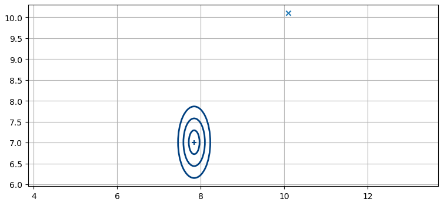

- Pg:293: Mahalanobis dist ~ Euclidean distance but in (std.dev) terms (S^-1) to incorporate uncertainty. If S=I, it results i euclidean distance formula.
- Pg:294 `2 Gate approach. (Rectangular gate, Ellipsidal gate next)`
- Pg:295 Practical difficulties of Designing KF
- Pg:295 Evaluating filter performance. When we have GT (NEES) (x_err = x_gt - x_est), E = x_err.T * P * x_err -> In scalar terms, ~(x^2/P) `if P is very small, then of even for small error, E increases.
- NEES is of  E[E]=n (n=state dim) ~ chi squared distribution, with n degrees of freedom. Take the mean value of NEES values, they should be less than n. **Essentially, when you have ground truth, use NEES score and state residuals to evaluate filter performance.**
- Pg:296 likelihood fn: Prob & likelihood are opposite teams with different i/p and o/p. Here, its measure of how likely is our filter performing optimally, given the assumptions of Gaussian noise and linear behaviour.

`y=z - Hx. S = HPH.T + R.`
`Likelihood = (1 / (2*pi*S)) * exp(-1/2 * y.T * s^-1 * y) ~ exp(S/y^2)`

- Essentially, likelihood is Gaussian with mean to be residual, and uncertainty (S) as covariance. Computing this is mathematically difficult. Hence, log likelihood is used. Taking log on both sides, log(L) = S/y^2
- As L->0, (S/y^2) -> log(0) = inf. (either y=0  or S=inf). So, if likelihood is low, if valid measurements, then filter is not optimal. Log likelihood is preferred as it more numerically stable. Pg:297-298. likelihood intuition. Ideally, if filter is optimial, log likelihood should be close to zero. If its not, value can go negatives.

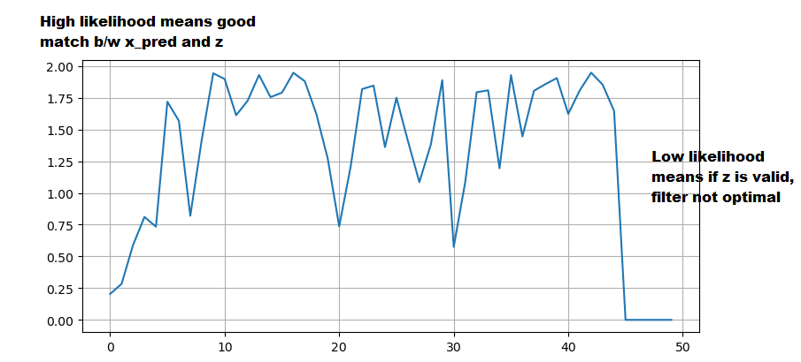

- Pg:299 Control I/P model change (eg steering and acc i/p)
- Pg:300-304, Wheelspeed and position sensor 2D Tracking example. **Covariance will incorportate all the information available, including geometry**
- Pg:304-308. GPS uses iterative least squares to triangulate position. **Conditions for Kalman filter inputs - Gaussian and time independent -  to saitsify Markov property**
- `Commercial GPS already has KF, O/p is filter o/p. Its not advisable for us to use that in another KF as our own ilter will track filtered o/p (not actual position). Plot shows lag, smooth o/p, which are very late to react to State changes.`

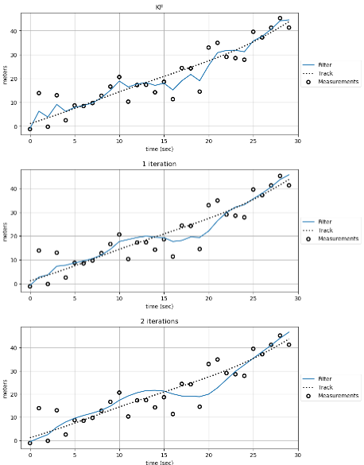

- Pg:309: Non-stationary process, (delta_T) might be defferent. Reset F,Q, and last time.
- Pg:311-312. Sensor fusion different rates. Separate F,Q,H,R as per each sensor. Sample code for 2 sensors of diff, rates
- Pg:323-326. Tracking ball in atmosphere. Difficult to model non-linearities with linear filter. Tuning Q with ↑ value gives high weightage to (z) causing filter to track (z) closely. Better to use non-linear KF
