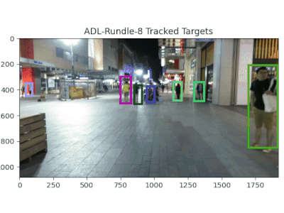

# SORT (Simple Online and Realtime Tracking)

## Overview
- [SORT](https://arxiv.org/abs/1602.00763), or Simple and online realtime tracking, as the name indicates, is a simple Real-time tracking algorithm, where detections from the previous and the current frame are associated using the Hungarian algorithm and the state of each track is estimated using a Kalman filter. The algorithm is simple, fast and effective for tracking multiple objects in real-time.
- Often used as a baseline for tracking multiple objects in real-time, SORT can be used in various applications such as surveillance, autonomous driving, and robotics.

- [SORT notes](SORT_notes.md) contains personal notes wrt original paper.

## References
- [SORT original paper](https://arxiv.org/abs/1602.00763)
- [SORT official github implementation - in python](https://github.com/abewley/sort)
- [SORT cpp implementation](https://github.com/yasenh/sort-cpp)
- [SORT python implementation with importance to reidentification](https://github.com/danbochman/SORT)
- [SORT cpp implementation reference](https://github.com/mcximing/sort-cpp)
